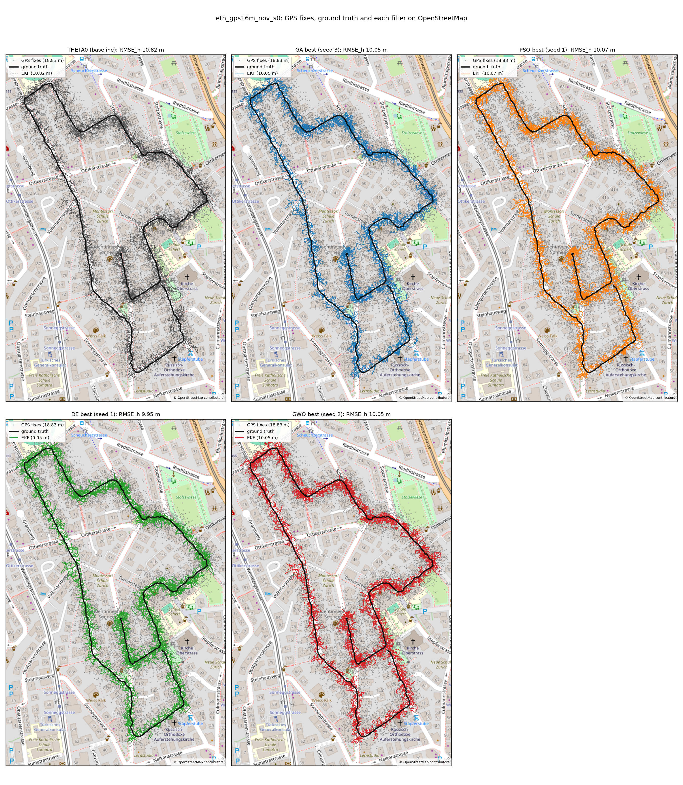
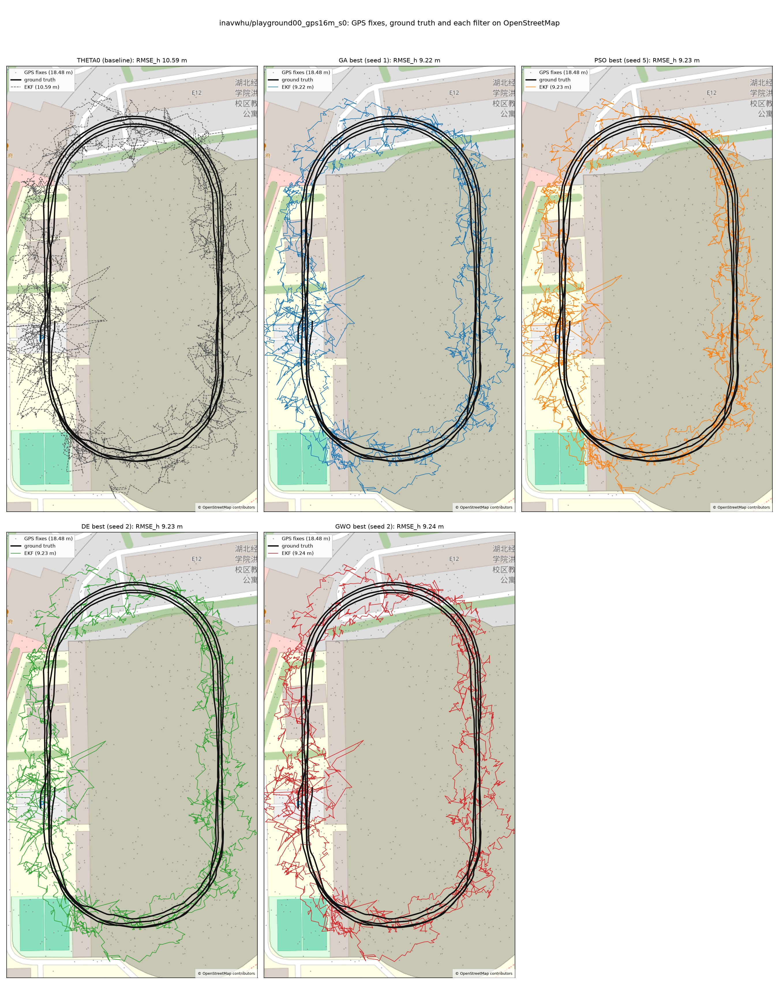
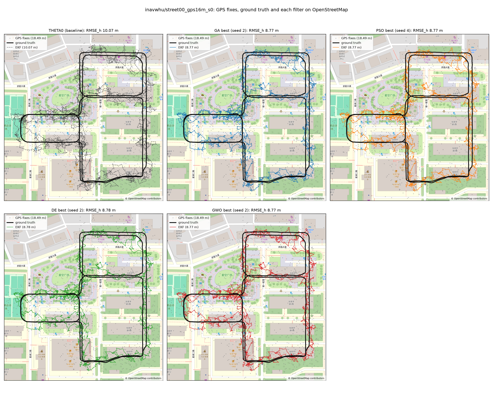
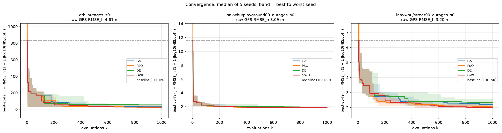
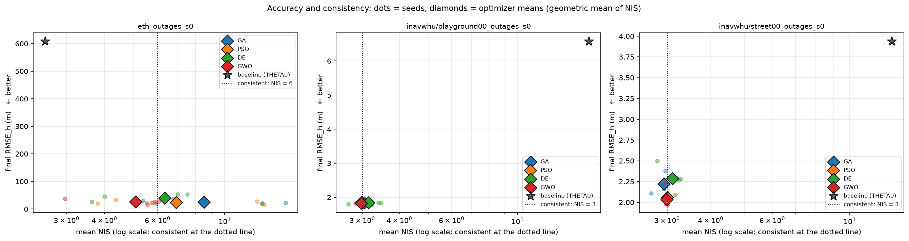
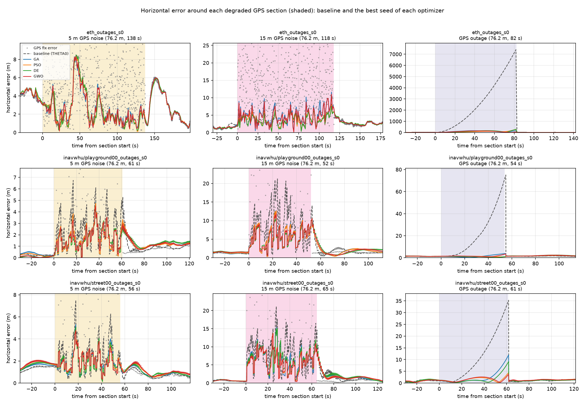
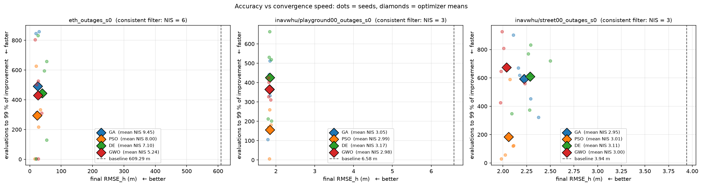
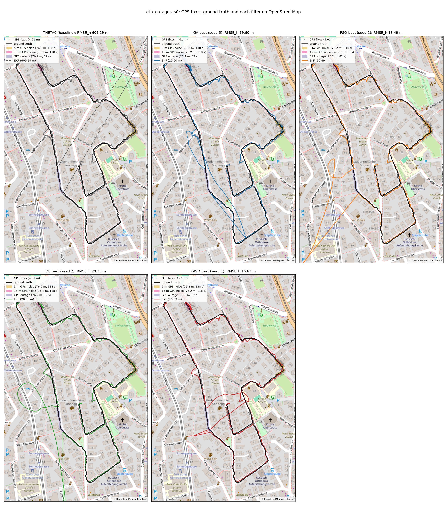
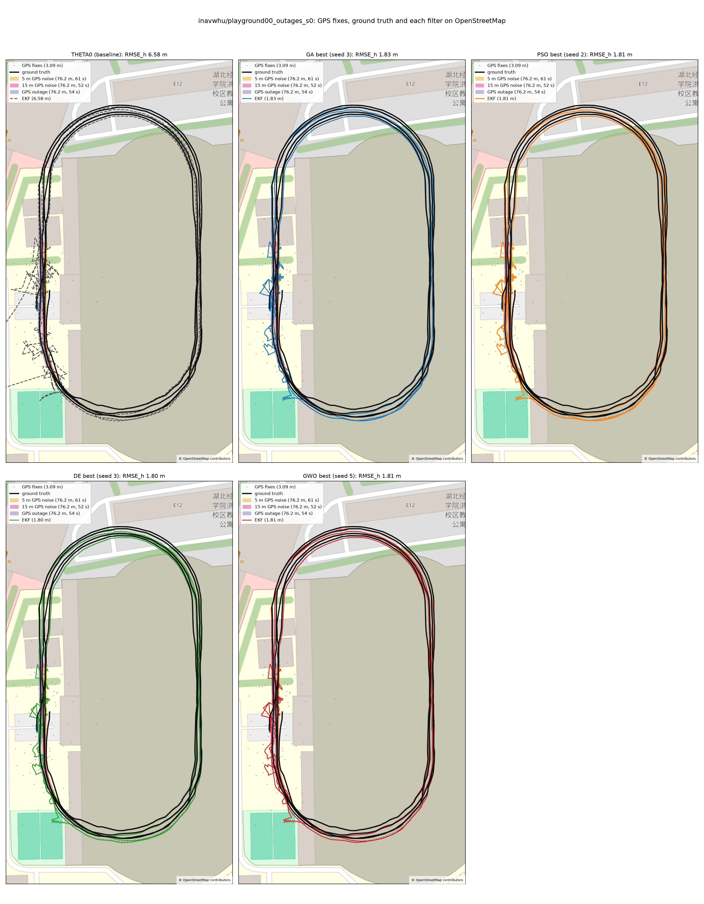
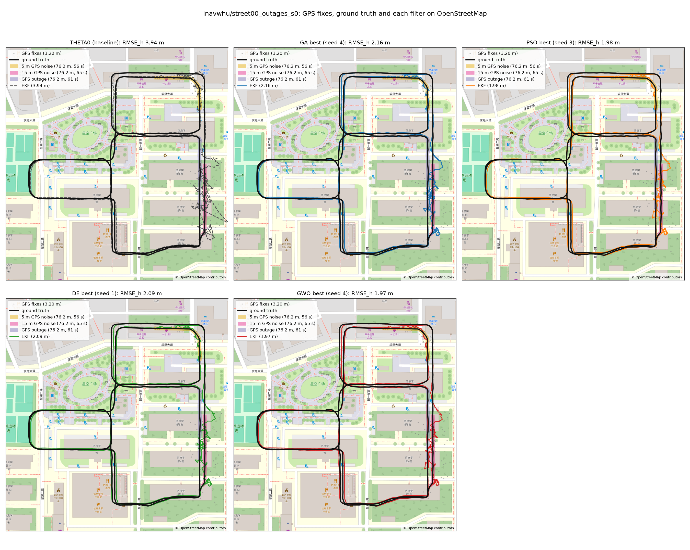

# Joint Tuning of Q and R in a GPS–IMU EKF

BTP I (MEMEC702), Netaji Subhas University of Technology, Mechanical Engineering.
Team: Anish Verma, Raghav Anthwal, Adrishikhar Deka, Sanvi Shokeen. Supervisor: Dr Vijayant Agarwal.

We tune the process noise **Q** and the measurement noise **R** together, offline, for one fixed 16-state GPS–IMU Extended Kalman Filter. Q and R are set once at the start of a run and stay constant. Four optimizers are benchmarked under identical conditions against the hand-set starting values (`THETA0`):

- Genetic Algorithm (GA)
- Particle Swarm Optimization (PSO)
- Differential Evolution (DE)
- Grey Wolf Optimizer (GWO)

**Methodology.** Q/R optimization is performed offline using the complete recorded flight. The primary optimization objective is whole-flight horizontal position RMSE.

The experiment evaluates the ability of the optimization algorithms to identify Q/R parameters for each of three recorded runs, separately: the ETH Zurich flight and the iNav-WHU `playground00` and `street00` drives, each with white noise added to its GPS (see [GPS noise and per-dataset THETA0](#gps-noise-and-per-dataset-theta0)), under a fixed budget of 1,000 evaluations per seed (population 100 × 10 generations) and 5 seeds per optimizer. Each dataset's filter starts from its own `THETA0`. It does not test generalization to unseen runs.

**Other datasets.** The EKF reads one processed dataset at a time, chosen with `--dataset` (ETH Zurich by default). A data pipeline turns the raw files of several other sources into the same format, and marks which ones can drive a GPS-aided EKF tuned against ground truth. Of the 93 datasets processed so far, ETH and the two iNav-WHU sequences can; see [Other datasets and the data pipeline](#other-datasets-and-the-data-pipeline) and [Results on other datasets](#results-on-other-datasets).

## Branches

| Branch | Holds |
|---|---|
| `main` | Everything needed to run the benchmark: the data (`data/`, `raw_data/`, `processed_data/`), the data pipeline, the EKF and fitness (`ekf/`), the four optimizers and their configs, `main.py`, the plotting scripts, this README and the results |
| `ga`, `pso`, `de`, `gwo`, `hisa` | One optimizer each: its code and its config file only |
| `data` | The datasets (`data/`, `raw_data/`, `processed_data/` for ETH and iNav-WHU) and the data pipeline only |
| `results` | The graphs and per-run files from `main.py` only |

Shared code (filter, fitness, pipeline) changes on `main`. An optimizer is edited on `main` and copied to its branch, so the two stay identical.

## Running everything

One command prepares the datasets, runs GA, PSO, DE and GWO on each of them, one optimizer at a time on the GPU, and builds every table and graph:

```bash
python main.py                      # scenario "outages" (the default)
python main.py --scenario gps16m    # the first run again
```

A scenario is a set of datasets with its own results folder, `results/<scenario>/` (`SCENARIOS` in `main.py`):

| Scenario | GPS | Results |
|---|---|---|
| `outages` (default) | Raw GPS, except three sections of 250 ft (76.2 m) of travel: about 5 m added error, about 15 m, and a complete outage ([below](#scenario-outages-raw-gps-with-degraded-sections)) | `results/outages/`, [run 2](#results-run-2-raw-gps-with-degraded-sections) |
| `gps16m` | 16 m white noise on every fix, position-only ([below](#gps-noise-and-per-dataset-theta0)) | `results/gps16m/`, [run 1](#results-run-1-16-m-gps-noise) |

| Option | Does |
|---|---|
| `--plan` | Prepares the datasets, then prints what would run and a time estimate |
| `--smoke` | Tiny budget (population 4, 8 evaluations, seed 1) into `results_smoke/<scenario>/`, to check the pipeline end to end |
| `--scenario` | `outages` (default) or `gps16m` |
| `--plots-only` | Rebuilds the tables and figures from `results/<scenario>/` |
| `--datasets`, `--optimizers` | A subset, e.g. `--datasets eth_outages_s0 --optimizers PSO GWO` |

It runs from `main` with a CUDA build of PyTorch and refuses to start on another branch. It is resumable: a seed whose `runs.csv` row, convergence curve and incumbents file are complete is skipped, so it can be stopped (Ctrl+C) and started again. A lock file (`results/<scenario>/.main.lock`) stops two runs from sharing the GPU. Everything printed goes to `results/<scenario>/main.log`, and every session is recorded in `results/<scenario>/main_manifest.json` (settings, versions, GPU, git commit, each dataset's `THETA0`, timings, checks).

It first prepares the datasets: a source missing from `processed_data/` is processed from `raw_data/`, and its degraded copy is written by `make_noisy_gps.py` (`SECTIONS` there for `outages`, `NOISE` in `main.py` for `gps16m`); both steps are skipped when the files are already there. Then, for each dataset, it:

1. centres `THETA0` and the bounds on that dataset (`ekf.load_data`, see below);
2. checks the GPU objective: the first 24 candidates GA scores for seed 1 are scored again by the filterpy reference on the CPU; the run stops if any difference in J, RMSE or NIS exceeds `TOL_RMSE = 1e-6` (absolute up to 1, relative above). A candidate whose filter is numerically chaotic (mean NIS above 1,000) is reported but not held to the tolerance: on `street00_gps64m_s0` one such candidate (mean NIS about 75,000, vertical error about 50 km) moves between 82 and 123 m on the CPU alone when its parameters change by 10⁻¹², so rounding decides its result on any backend;
3. scores the baseline `THETA0`;
4. runs GA, PSO, DE and GWO, five seeds each, then checks that every seed used exactly 1,000 evaluations (`n_evals`, `n_objective_evals` and the convergence-curve rows), and scores the mean NIS of every incumbent (each best-so-far θ) of every seed on the GPU (`ekf/response.py`), kept as data in `incumbents_seed<s>.csv`;
5. writes the dataset's table and convergence figure.

Then it writes `results/<scenario>/summary/`: one table over all datasets, the best values, a convergence figure and an accuracy-vs-convergence figure, one panel per dataset; the maps (`plot_maps.py`); and, for `outages`, the per-section metrics and figure (`plot_sections.py`).

**Time.** On an RTX 4060 Laptop GPU run 1 (`gps16m`) took 9.77 h: 0.63 h for ETH, 4.43 h for `playground00` and 4.68 h for `street00` (`--plan` estimated 6.0 h; it scales from batches of 200 candidates, and at population 100 a candidate costs about 1.5 times as much).

## GPS noise and per-dataset THETA0

**Why noise.** The clean datasets' GPS is much better than their IMU (on iNav-WHU almost all of its error is slow bias, see [below](#why-the-ekf-cannot-do-much-better-than-gnss)), so every tuning ends at raw GPS and the optimizers cannot be told apart. White noise on the GPS fixes gives the filter something to remove. `ekf.degrade_gps` adds it (horizontal σ, vertical 1.5 σ, seed 0); `make_noisy_gps.py` writes it as a derived dataset, `processed_data/<source>_gps<σ>m_s0/`, which holds only `gps.csv` and `meta.json` and takes its IMU and ground truth from the source. IMU and ground truth are never changed.

**How much.** For each dataset and σ, `THETA0` was centred on that noise and `THETA0` plus 199 random candidates from the bounds were scored on the GPU. The noise used is the largest at which no candidate diverges, the filter still beats the noisy GPS, and the best candidate still beats `THETA0` by more than 1 %:

| σ (m) | ETH: raw GPS → best (gain over `THETA0`) | `playground00`: raw → best (gain) | `street00`: raw → best (gain) |
|---:|---|---|---|
| 1 | 3.75 → 3.67 m (3.1 %) | 1.62 → 1.38 m (5.2 %) | 1.54 → 1.29 m (4.2 %) |
| **2** | **4.23 → 3.77 m (1.7 %)** | 2.58 → 1.83 m (10.1 %) | 2.52 → 1.72 m (10.0 %) |
| 4 | 5.79 → 3.94 m (0.4 %) | 4.76 → 3.03 m (10.9 %) | 4.72 → 3.57 m (10.1 %) |
| 8 | 9.87 → 4.19 m (0 %) | 9.30 → 5.43 m (9.5 %) | 9.28 → 4.81 m (12.4 %) |
| **16** | 18.8 → 4.64 m (0 %) | **18.5 → 9.35 m (11.7 %)** | **18.5 → 8.85 m (12.2 %)** |
| 32 | 37.2 → 5.43 m (0.8 %) | 36.9 → 16.5 m (15.3 %) | 37.0 → 17.0 m (17.3 %) |
| 64 | – | 73.7 → 28.5 m (21.1 %) | 73.9 → 30.8 m (13.0 %) |
| 128 | – | 147 → 52.1 m (19.9 %), **1 of 200 diverged** | 148 → 54.3 m (17.9 %) |

So run 1 (scenario `gps16m`) uses σ = 16 m on every dataset: **`eth_gps16m_nov_s0`**, **`inavwhu/playground00_gps16m_s0`** and **`inavwhu/street00_gps16m_s0`**, a raw GPS error of 18.5–18.8 m, in the 15–20 m range of a poor receiver. The gain keeps growing with the noise on iNav-WHU and the first divergence appears at 128 m, but noise that large is not a realistic receiver.

**ETH is position-only.** iNav-WHU's F9P reports no velocity, but ETH's GPS does, and with clean velocity the filter barely needs position: at σ = 16 m tuning gains 0 %, and with 0.5 to 8 m/s of velocity noise at most 0.9 % (THETA0 plus 199 random candidates). With the velocity dropped (`make_noisy_gps.py --no-velocity`, `_nov` in the name) ETH at 16 m behaves like iNav-WHU: 18.8 m raw, 10.8 m at `THETA0`, and tuning gains 4.7 %. All three datasets then use the same GPS channels (position, 3 NIS degrees of freedom). Earlier runs used ETH at 2 m with velocity and iNav-WHU at 64 m; their results are in the git history.

**Per-dataset THETA0.** `THETA0` and its bounds used to come from the ETH sensor for every dataset, which put the iNav-WHU sensor's own noise outside the search. Now `ekf.load_data` gives each dataset its own `THETA0` (`ekf.data.dataset_theta0`) and re-centres the bounds on it (`THETA0` ± 3 for Q, ± 2 for R; `ekf.tuning.set_search_space`), so each dataset's filter starts from, and searches around, its own sensors:

- ETH keeps the hand-set `THETA0` (built from the same statistics, see [Decision vector](#decision-vector)).
- Other sources: `q_acc` and `q_gyro` from the IMU's first 10 s at rest (variance × sample interval); `r_xy` and `r_z` from the receiver's reported σ (`std_e`, `std_n`, `std_u`) when the GPS file has them.
- The bias random walks and `r_vel` keep the ETH values.
- Noise added by `make_noisy_gps.py` is added to R.

| Dataset | `log_q_acc` | `log_q_gyro` | `log_q_ba` | `log_q_bg` | `log_r_xy` | `log_r_z` | `log_r_vel` |
|---|---:|---:|---:|---:|---:|---:|---:|
| `eth_gps16m_nov_s0` | 0.20 | −3.00 | −5.00 | −8.00 | 2.42 | 2.78 | 0.00 (unused: no velocity) |
| `playground00_gps16m_s0` | −5.40 | −8.32 | −5.00 | −8.00 | 2.41 | 2.76 | 0.00 |
| `street00_gps16m_s0` | −5.57 | −8.84 | −5.00 | −8.00 | 2.41 | 2.76 | 0.00 |

Every `runs.csv` row records the dataset's `THETA0` (`theta0_<name>` columns).

## Scenario `outages`: raw GPS with degraded sections

Run 1 put 16 m of noise on every fix. The second scenario keeps each receiver's own GPS and degrades it only where a real receiver would struggle, three times per drive, so the filter's accuracy with good GPS and its behaviour when GPS goes bad are both measured. `make_noisy_gps.py --sections` (`SECTIONS`, `SECTION_M`) writes `processed_data/<source>_outages_s0/`:

- three sections of **250 ft (76.2 m) of travel each**, centred at 25 %, 50 % and 75 % of the ground-truth path length;
- section 1: **about 5 m** of added horizontal error (white, σ = 5/√2 m per axis, vertical 1.5 times that per axis);
- section 2: **about 15 m** (σ = 15/√2 m per axis);
- section 3: **complete outage**: the fixes are removed, and the filter runs on the IMU alone;
- ETH's GPS velocity is kept (it is raw GPS) and gets 0.5 and 1.5 m/s of white noise in sections 1 and 2; iNav-WHU has no GPS velocity;
- seed 0, so every optimizer sees the same fixes. `THETA0` is the raw dataset's (no added noise in R): the filter is tuned for the receiver it normally has and is not told when the GPS degrades.

The sections, as written (GPS error = horizontal RMS error of the fixes against the truth at each fix's time):

| Dataset | Raw GPS (whole drive) | Section 1, 5 m | Section 2, 15 m | Section 3, outage |
|---|---:|---|---|---|
| `eth_outages_s0` | 3.60 m | t 752–890 s (138 s), 689 fixes, 2.80 → 5.61 m | t 1576–1694 s (118 s), 589 fixes, 3.18 → 15.17 m | t 2145–2227 s (82 s), 411 fixes removed |
| `playground00_outages_s0` | 1.12 m | t 331–391 s (61 s), 61 fixes, 0.28 → 4.87 m | t 649–701 s (52 s), 53 fixes, 1.26 → 17.19 m | t 950–1004 s (54 s), 54 fixes removed |
| `street00_outages_s0` | 1.03 m | t 311–368 s (56 s), 56 fixes, 1.28 → 4.93 m | t 654–719 s (65 s), 64 fixes, 0.44 → 16.91 m | t 993–1055 s (61 s), 61 fixes removed |

The vehicles are slow (about 1.3 m/s on iNav-WHU, 0.6–0.9 m/s on ETH in these places), so 76.2 m of travel lasts 52–138 s.

**GPS plausibility rule.** In this scenario the filter discards any fix the platform could not have reached since the last accepted one, and keeps its IMU prediction instead ([GPS plausibility rule](#gps-plausibility-rule)).

**Objective: accuracy and consistency.** Run 1 minimised RMSE_h alone, and its tuned filters ended far from consistent: mean NIS 0.1–1 on iNav-WHU and up to 190 on ETH, against 3 for a consistent filter. This scenario scores both measures, over the whole drive with the sections included:

$$J(\theta) = \text{RMSE}_h \cdot \left(1 + w \left|\log_{10}\frac{\overline{\text{NIS}}}{\text{dof}}\right|\right), \qquad w = 1$$

so a filter whose mean NIS equals the number of GPS channels used (dof: 6 on ETH, with velocity; 3 on iNav-WHU) scores its RMSE_h, and one that is 10 times over- or underconfident counts double ([Canonical fitness](#canonical-fitness)). On 200 random candidates per dataset (`THETA0` and 199 uniform in the bounds, on the GPU), the lowest RMSE_h on `playground00` is 1.82 m at mean NIS 94.5, and the lowest J is 2.03 m at NIS 3.23. On `street00` J picks 2.39 m at NIS 3.06, rather than 2.26 m at NIS 4.19. On ETH both pick the same candidate, 53.1 m at NIS 2.15.

**What `plot_sections.py` reports.** For the baseline and the best seed of each optimizer, rerun on the filterpy reference, per section: the filter's RMSE_h and largest error in the section, its error when the section ends (for the outage, the drift on the IMU alone), RMSE_h over the next 30 s, the seconds until the error is back within the filter's own RMSE_h outside the sections, and the mean NIS of the updates in the section (how far the filter's confidence is from the degraded GPS); plus each run's RMSE_h outside the sections and over the whole drive. Files: `sections.md`/`.csv`/`.png` per dataset and in `summary/`; the maps also mark the three sections on the ground truth.

**Before tuning.** At `THETA0` the outage costs very different amounts on the two sensors. The iNav-WHU ADIS16465 (200 Hz) drifts to 62 m (`playground00`) and 21 m (`street00`) by the end of its 54–61 s outage. ETH's IMU (10 Hz) drifts to 7.4 km in 82 s, so ETH's whole-drive RMSE_h at `THETA0` is 611 m, against 5.4 and 3.0 m on iNav-WHU. ETH's tuning will therefore be mostly about the outage drift; its RMSE_h outside the sections (3.9 m at `THETA0`) is in the section tables. With the drift this large the GPU still matches filterpy to 10⁻¹¹ m (`THETA0` and 5 random candidates).

## Optimizers

All four use the same budget, the same decision vector and bounds, the same fitness and the GPU backend. Settings are in each `<NAME>_config.py`.

| | GA | PSO | DE | GWO |
|---|---|---|---|---|
| Population × generations | 100 × 10 | 100 × 10 | 100 × (1 + 9) | 100 × 10 |
| Evaluations per seed | 1,000 | 1,000 | 1,000 | 1,000 |
| Seeds | 1–5 | 1–5 | 1–5 | 1–5 |
| Operators | tournament 3, 2 elites, BLX-0.5 crossover (0.9), Gaussian mutation (0.2, σ = 10 % of range) | global best, inertia 0.9 → 0.4, c1 = c2 = 1.49445, velocity clamp 20 %, absorbing walls | DE/rand/1/bin, F = 0.7, CR = 0.9, greedy selection | α/β/δ leaders, a from 2 to 0 |
| Starting population | uniform in bounds, `THETA0` as one individual | uniform in bounds | uniform in bounds, `THETA0` as one individual | uniform in bounds, `THETA0` as one wolf |

HISA, on the `hisa` branch, searches a different decision vector (initial biases and R) at its own budget, so it is not part of `main.py`.

## Layout

| Path | Purpose |
|---|---|
| `data/` | The cleaned ETH Zurich flight. Do not clean it again |
| `raw_data/` | Raw files of every other dataset (not in git, large) |
| `data_pipeline/` | Adapters that turn `raw_data/` into one canonical format, with an `ekf_ready` verdict per dataset |
| `processed_data/` | The pipeline's output, one folder per dataset (generated, ignored by git). The EKF reads only this |
| `ekf/data.py` | `load_data(dataset)` from `processed_data/` (a derived dataset reads IMU and truth from its source), the per-dataset `THETA0`, dataset selection, `degrade_gps`, and `perturb`/`PERTURBATIONS` for `ekf.robustness` |
| `ekf/filter.py` | The EKF, built on `filterpy.kalman.ExtendedKalmanFilter` |
| `ekf/tuning.py` | Decision vector, bounds, `theta_to_QR`, the canonical `fitness`, `FitnessTracker`, `robustness` and the result helpers |
| `ekf/gpu.py` | The same EKF batched over candidates on the GPU (PyTorch, float64), used by `FitnessTracker(backend="gpu")`, and `compare_with_cpu` |
| `ekf/response.py` | Mean NIS of every incumbent of a run (on the GPU), and the accuracy-NIS-compute path of a seed |
| `GA.py`, `PSO.py`, `DE.py`, `GWO.py` | The optimizers; settings in `<NAME>_config.py` |
| `main.py` | Prepares the datasets, runs every optimizer on each and builds all outputs |
| `reset.py` | Removes one scenario's generated data (`results/<scenario>/` and its degraded datasets) so its next run starts from scratch; `--all` removes everything generated |
| `make_noisy_gps.py` | Writes a derived dataset with white (and optionally Gauss-Markov) noise on its GPS, or (`--sections`) raw GPS with the three degraded sections |
| `plot_response.py` | Tables, convergence figures and the accuracy-vs-convergence figure, from the results |
| `plot_maps.py` | OpenStreetMap maps per dataset: ground truth, GPS, baseline EKF and each optimizer's best run (`map.png`, `map.html`) |
| `plot_sections.py` | Scenario `outages`: each filter's error and consistency in and after each degraded GPS section (`sections.md`, `sections.png`) |
| `run_baseline.py` | Evaluates `THETA0` through the same fitness and writes `results/baseline/` (`results/<dataset>/baseline/` for other datasets) |
| `plot_trajectories.py` | Map of ground truth, GNSS and EKF trajectories in local ENU, with the error over time |

## Quick start

```bash
pip install -r requirements.txt
python reset.py                                 # remove the current scenario's results and datasets (asks first)
python main.py --plan                           # prepare the datasets; what the benchmark will do, and how long
python main.py                                  # the full benchmark

# single pieces
python run_baseline.py                          # ETH Zurich flight
python GA.py --dataset inavwhu/playground00     # one optimizer on one dataset

# any other dataset: process it, then run on it
python -m data_pipeline --list                  # datasets and their EKF status
python -m data_pipeline --select inavwhu/street00
python run_baseline.py --dataset inavwhu/street00     # asks on a terminal if --dataset is omitted
python PSO.py --dataset inavwhu/street00
python plot_trajectories.py --dataset inavwhu/street00
```

```python
import numpy as np
import ekf

data = ekf.load_data()
J = ekf.fitness(data, ekf.THETA0)                 # whole-flight horizontal RMSE, metres

# What every optimizer calls: same fitness, plus budget, best-so-far history and timing
seed = 0
cost_fn = ekf.make_cost_fn(data, max_evals=1000, n_workers=8)
population = np.random.default_rng(seed).uniform(ekf.LOWER, ekf.UPPER, (20, 7))
costs = cost_fn.evaluate_many(population)         # or cost_fn(theta) for one candidate
# ... the optimizer's own loop, until cost_fn.exhausted ...
row, _ = ekf.run_summary(data, cost_fn, "GA", seed, rmse_baseline=J)
ekf.save_run("results/GA", row, cost_fn)          # runs.csv + convergence_seed<seed>.csv
cost_fn.close()
```

With `n_workers > 1` the script must run its optimizer under `if __name__ == "__main__":`, which Windows multiprocessing requires.

To score each population as one batch on the GPU instead, pass `backend="gpu"` (needs a CUDA build of PyTorch, see `requirements.txt`):

```python
cost_fn = ekf.make_cost_fn(data, max_evals=2000, backend="gpu")
costs = cost_fn.evaluate_many(population)         # 200 candidates -> one batched EKF pass
```

## Results: run 1, 16 m GPS noise

Scenario `gps16m`, saved in `results/gps16m/` (`python main.py --scenario gps16m --plots-only` rebuilds its figures).


`python main.py` on an RTX 4060 Laptop GPU, 20–21 November 2026: GA, PSO, DE and GWO, population 100 × 10 generations = 1,000 evaluations × seeds 1–5, on `eth_gps16m_nov_s0`, `playground00_gps16m_s0` and `street00_gps16m_s0` (16 m GPS noise, position-only, raw GPS error 18.5–18.8 m), each starting from its own `THETA0`. Total 9.77 h (ETH 0.63 h, `playground00` 4.43 h, `street00` 4.68 h). The GPU-vs-filterpy check passed on all three datasets (largest scaled difference 3.4 × 10⁻⁹, no chaotic candidates), and every seed used exactly 1,000 evaluations. All numbers are re-scored by the filterpy reference. Full tables: [`results/gps16m/summary/results_table.md`](results/gps16m/summary/results_table.md) and [`results/gps16m/summary/best_values.md`](results/gps16m/summary/best_values.md).

### Headline numbers

Mean ± std over 5 seeds. A consistent filter has mean NIS 3 (position-only GPS).

| Dataset (raw GPS error) | Method | RMSE_h (m) | vs baseline (m) | vs raw GPS (m) | Mean NIS | Evals to 99 % | Time per seed |
|---|---|---:|---:|---:|---:|---:|---:|
| ETH (18.83 m) | Baseline (`THETA0`) | 10.818 | – | −8.01 | 2.99 | – | – |
| | GA | 10.119 ± 0.049 | −0.699 | −8.71 | 48.9 | 817 ± 169 | 1.7 min |
| | PSO | 10.155 ± 0.068 | −0.663 | −8.67 | 7.5 | 536 ± 389 | 1.7 min |
| | DE | 10.114 ± 0.200 | −0.704 | −8.71 | 193.3 | 706 ± 201 | 1.7 min |
| | **GWO** | **10.113 ± 0.059** | **−0.705** | **−8.72** | 5.9 | 827 ± 79 | 1.7 min |
| `playground00` (18.48 m) | Baseline (`THETA0`) | 10.587 | – | −7.89 | 2.93 | – | – |
| | GA | 9.241 ± 0.025 | −1.346 | −9.24 | 0.98 | 658 ± 259 | 12.3 min |
| | **PSO** | **9.231 ± 0.008** | **−1.357** | **−9.25** | 0.42 | 384 ± 263 | 12.3 min |
| | DE | 9.277 ± 0.050 | −1.310 | −9.20 | 0.55 | 429 ± 281 | 12.3 min |
| | GWO | 9.268 ± 0.028 | −1.320 | −9.21 | 0.45 | 511 ± 164 | 12.3 min |
| `street00` (18.49 m) | Baseline (`THETA0`) | 10.072 | – | −8.42 | 2.90 | – | – |
| | GA | 8.781 ± 0.007 | −1.291 | −9.71 | 0.11 | 719 ± 129 | 13.0 min |
| | PSO | 8.778 ± 0.006 | −1.294 | −9.71 | 0.09 | 261 ± 111 | 13.0 min |
| | DE | 8.788 ± 0.006 | −1.284 | −9.70 | 0.21 | 558 ± 272 | 13.0 min |
| | **GWO** | **8.777 ± 0.007** | **−1.295** | **−9.71** | 0.11 | 479 ± 160 | 13.0 min |

### Best values found

The best seed of each optimizer (log10 of the noise densities and variances; bounds are the dataset's `THETA0` ± 3 for Q and ± 2 for R; `log_r_vel` has no effect, as there is no GPS velocity).

| Dataset | Optimizer (seed) | RMSE_h (m) | NIS | `log_q_acc` | `log_q_gyro` | `log_q_ba` | `log_q_bg` | `log_r_xy` | `log_r_z` |
|---|---|---:|---:|---:|---:|---:|---:|---:|---:|
| ETH | `THETA0` | 10.818 | 2.99 | 0.20 | −3.00 | −5.00 | −8.00 | 2.42 | 2.78 |
| | GA (3) | 10.053 | 16.98 | −2.80 | −3.23 | −2.35 | −7.08 | 1.76 | 1.86 |
| | PSO (1) | 10.071 | 12.93 | −0.13 | −3.34 | −2.00 | −6.90 | 1.70 | 2.29 |
| | **DE (1)** | **9.952** | 53.82 | 3.20 | −0.81 | −2.00 | −11.00 | 4.42 | 0.78 |
| | GWO (2) | 10.046 | 9.95 | −0.20 | −3.31 | −2.00 | −7.31 | 1.71 | 4.49 |
| `playground00` | `THETA0` | 10.587 | 2.93 | −5.40 | −8.32 | −5.00 | −8.00 | 2.41 | 2.76 |
| | **GA (1)** | **9.221** | 1.22 | −6.60 | −11.20 | −4.82 | −8.61 | 3.56 | 2.72 |
| | PSO (5) | 9.226 | 0.56 | −5.38 | −8.56 | −4.74 | −8.52 | 3.60 | 3.12 |
| | DE (2) | 9.232 | 0.25 | −5.65 | −10.65 | −5.52 | −8.45 | 3.63 | 3.66 |
| | GWO (2) | 9.236 | 0.14 | −7.60 | −11.32 | −4.89 | −8.61 | 3.61 | 4.76 |
| `street00` | `THETA0` | 10.072 | 2.90 | −5.57 | −8.84 | −5.00 | −8.00 | 2.41 | 2.76 |
| | GA (2) | 8.772 | 0.08 | −4.20 | −5.84 | −8.00 | −7.56 | 4.39 | 4.00 |
| | **PSO (4)** | **8.769** | 0.09 | −6.48 | −5.87 | −8.00 | −7.55 | 4.41 | 3.90 |
| | DE (2) | 8.782 | 0.10 | −6.58 | −8.29 | −8.00 | −7.49 | 4.41 | 3.84 |
| | **GWO (2)** | **8.769** | 0.10 | −6.00 | −5.84 | −8.00 | −7.53 | 4.40 | 3.84 |

### What the results show

1. **The filter halves the GPS error, and tuning adds 6–13 %.** With 16 m GPS noise every filter cuts the raw GPS error of about 18.5 m to 8.8–10.2 m. Tuning Q and R improves on `THETA0` by about 0.70 m (6.5 %) on ETH and 1.3 m (12.8–12.9 %) on both iNav-WHU drives.
2. **The four optimizers end almost level.** On iNav-WHU the means differ by at most 0.05 m, about the seed-to-seed spread; PSO is best on `playground00` (9.231 m) and GWO, PSO and GA tie on `street00` (8.777–8.781 m). On ETH GWO, DE and GA lie within 0.006 m (10.113–10.119 m) and PSO 0.04 m behind, but DE varies most between seeds (± 0.20 m) while also finding the best single run (9.952 m).
3. **PSO converges fastest.** On iNav-WHU PSO reaches 99 % of its improvement after 384 and 261 evaluations, against 479–719 for the others, and has the smallest spread on `playground00` (± 0.008 m).
4. **The tuned filters are not consistent.** On iNav-WHU mean NIS falls from about 3 at `THETA0` to 0.1–1.0 (underconfident: R grows to about 10^4.4 m² on `street00`, an assumed GPS σ of about 160 m against the true 16 m, so the filter leans on the IMU). On ETH it rises to 6–193 (overconfident), most for DE and GA.
5. **Overconfident DE runs on ETH are chaotic.** For DE seeds 2 and 3 (mean NIS 373 and 279) the GPU search and the filterpy reference disagree by 0.009 and 0.35 m on the same θ, the numerical chaos described in [Running everything](#running-everything); the table reports the reference values, 10.142 and 10.448 m. Every other run agrees to within 10⁻¹² m.
6. **Several optimum values sit on a bound.** On `street00` all four put `log_q_ba` at its lower bound −8 and GA and GWO put `log_q_gyro` at its upper bound −5.84; on ETH three put `log_q_ba` at its upper bound −2, and DE also hits `log_q_acc` 3.20 and `log_q_bg` −11; on `playground00` GWO's `log_q_gyro` sits at its lower bound −11.32.
7. **Compute.** A seed takes 1.7 min on ETH and 12.3–13 min on iNav-WHU; the run took 9.77 h against the 6.0 h `--plan` estimate (batches of 100 are less efficient than the 200 the estimate assumes).

### Graphs

**Convergence: best-so-far RMSE_h against evaluations, median of 5 seeds; band = best to worst seed**


**Accuracy vs convergence speed: one dot per seed, one diamond per optimizer mean**


Per-dataset convergence with every seed: [`eth_gps16m_nov_s0`](results/gps16m/eth_gps16m_nov_s0/convergence.png), [`playground00_gps16m_s0`](results/gps16m/inavwhu/playground00_gps16m_s0/convergence.png), [`street00_gps16m_s0`](results/gps16m/inavwhu/street00_gps16m_s0/convergence.png).

### Maps

One map per filter for each dataset: the baseline EKF at `THETA0` (dashed) and the best seed of GA, PSO, DE and GWO, each drawn over the noisy GPS fixes (grey dots) and the ground truth (black) on OpenStreetMap (`plot_maps.py`; tracks rerun on the filterpy reference). An interactive version with all tracks in one map, which you can pan, zoom and toggle, is `map.html` in each dataset folder (download and open in a browser).

**ETH:** every filter follows the streets through the 18.8 m GPS cloud; the tuned tracks hug the truth more tightly than the baseline.



**`playground00`**



**`street00`**



## Results: run 2, raw GPS with degraded sections

`python main.py` (scenario `outages`) on an RTX 4060 Laptop GPU, 22 November 2026: GA, PSO, DE and GWO, population 100 × 10 generations = 1,000 evaluations × seeds 1–5, on `eth_outages_s0`, `playground00_outages_s0` and `street00_outages_s0`, each from its own `THETA0`. Setup:
- the raw GPS of each receiver, with three sections of 76.2 m (250 ft) of travel: about 5 m added error, about 15 m, and an outage ([scenario](#scenario-outages-raw-gps-with-degraded-sections));
- the objective J, which weighs RMSE_h by NIS consistency ([Canonical fitness](#canonical-fitness));
- the GPS plausibility rule on ([GPS plausibility rule](#gps-plausibility-rule)).

Total 9.75 h: ETH 0.65 h, `playground00` 4.40 h, `street00` 4.64 h. The GPU-vs-filterpy check of J passed on all three datasets (largest scaled difference 7.1 × 10⁻⁹, no chaotic candidates), and every seed used exactly 1,000 evaluations. All numbers are re-scored by the filterpy reference. Full tables:
- [`results/outages/summary/results_table.md`](results/outages/summary/results_table.md)
- [`best_values.md`](results/outages/summary/best_values.md)
- [`sections.md`](results/outages/summary/sections.md)

### Headline numbers

Mean ± std over 5 seeds, over the whole drive with the sections included. Raw GPS is the error of the degraded fixes. A consistent filter has mean NIS = dof: 6 on ETH (position and velocity), 3 on iNav-WHU.

| Dataset (raw GPS) | Method | J | RMSE_h (m) | Mean NIS (dof) | Evals to 99 % | Time per seed |
|---|---|---:|---:|---:|---:|---:|
| ETH (4.61 m) | Baseline (`THETA0`) | 835.7 | 609.29 | 2.55 (6) | – | – |
| | GA | 29.38 ± 6.50 | 25.44 ± 6.94 | 9.45 | 491 ± 366 | 1.8 min |
| | PSO | 28.86 ± 7.84 | 24.00 ± 6.62 | 8.00 | 294 ± 225 | 1.8 min |
| | DE | 45.83 ± 15.01 | 39.90 ± 15.67 | 7.10 | 444 ± 358 | 1.8 min |
| | **GWO** | **28.62 ± 12.11** | 26.06 ± 7.68 | 5.24 | 429 ± 296 | 1.8 min |
| `playground00` (3.09 m) | Baseline (`THETA0`) | 11.60 | 6.582 | 17.37 (3) | – | – |
| | GA | 1.853 ± 0.011 | 1.836 ± 0.029 | 3.05 | 366 ± 159 | 12.2 min |
| | PSO | 1.848 ± 0.024 | 1.844 ± 0.024 | 2.99 | 156 ± 92 | 12.2 min |
| | DE | 1.922 ± 0.022 | 1.847 ± 0.037 | 3.17 | 425 ± 208 | 12.2 min |
| | **GWO** | **1.845 ± 0.025** | **1.834 ± 0.028** | 2.98 | 365 ± 48 | 12.2 min |
| `street00` (3.20 m) | Baseline (`THETA0`) | 6.475 | 3.940 | 13.20 (3) | – | – |
| | GA | 2.265 ± 0.098 | 2.222 ± 0.109 | 2.95 | 593 ± 221 | 12.9 min |
| | PSO | 2.063 ± 0.055 | 2.059 ± 0.056 | 3.01 | 183 ± 230 | 12.9 min |
| | DE | 2.347 ± 0.152 | 2.287 ± 0.144 | 3.11 | 609 ± 231 | 12.9 min |
| | **GWO** | **2.041 ± 0.112** | **2.037 ± 0.110** | 3.00 | 673 ± 198 | 12.9 min |

### In the sections

The best seed of each optimizer against the baseline (`plot_sections.py`, all numbers in [`sections.md`](results/outages/summary/sections.md)). RMSE_h in metres. "Outage end" is the error when the GPS comes back, which is the drift on the IMU alone.

| Dataset | Filter | 5 m section | 15 m section | Outage: RMSE_h | Outage end | Outside the sections |
|---|---|---:|---:|---:|---:|---:|
| ETH | Baseline | 3.11 | 4.06 | 3,489 | 7,403 | 3.91 |
| | GA / PSO / DE / GWO | 3.06–3.11 | 3.89–5.41 | 92–114 | 50–292 | 3.82–3.93 |
| `playground00` | Baseline | 2.81 | 9.97 | 28.75 | 71.43 | 1.12 |
| | GA / PSO / DE / GWO | 1.85–1.96 | 5.74–6.36 | 0.99–1.75 | 0.88–3.80 | 1.16–1.29 |
| `street00` | Baseline | 2.81 | 9.13 | 14.71 | 34.74 | 1.12 |
| | GA / PSO / DE / GWO | 2.12–2.18 | 6.56–7.30 | 1.64–3.54 | 3.52–11.59 | 1.19–1.28 |

### What the results show

1. **Tuning makes the iNav-WHU filter bridge the outage.** At `THETA0` the 54–61 s outage ends 71 m (`playground00`) and 35 m (`street00`) off. The tuned filters end it 0.9–3.8 m and 3.5–11.6 m off, so the whole-drive RMSE_h falls from 6.58 to 1.83 m and from 3.94 to 2.04 m. That is 41 % and 36 % below the raw GPS (3.09 and 3.20 m with the sections). The price is small: outside the sections the tuned filters are 0.04–0.17 m worse than `THETA0` (1.16–1.29 against 1.12 m), which trusts the receiver's ~1 m fixes more.
2. **The noisy sections are smoothed.** In the 15 m section (GPS error about 17 m) the tuned iNav-WHU filters stay at 5.7–7.3 m, against 9.1–10.0 m at `THETA0`; in the 5 m section 1.9–2.2 m against 2.8 m. On ETH, GPS velocity keeps every filter at 3–5 m in both noisy sections, tuned or not.
3. **NIS is consistent now.** With J, every iNav-WHU optimizer ends at mean NIS 2.95–3.17 for 3 (run 1: 0.1–1), and ETH at 5.2–9.5 for 6. `THETA0` is overconfident on the degraded GPS (13–17 on iNav-WHU). The mean is over the whole drive. The filter is not told when the GPS degrades, so inside the 15 m section its NIS is still 58–65 on iNav-WHU and 99–235 on ETH, and it is slightly underconfident elsewhere to make up for it.
4. **ETH's IMU cannot bridge 82 s.** Tuning cuts the outage drift from 7.4 km to 50–292 m and the whole-drive RMSE_h from 609 m to 16.5–53.5 m, but that is still well above the raw GPS (4.61 m). The result depends on the seed (± 7–16 m). GA and DE seed 2 end on the identical θ: both start from the same initial population for the same seed, found their best at evaluation 3, and never improved on it in the other 997. On ETH, J is dominated by how the outage drift happens to fall, which the optimizers cannot steer well.
5. **GWO and PSO lead.** GWO has the best mean J on all three datasets. PSO is within 0.003 (`playground00`) and 0.02 (`street00`) of it, has the smallest spread on `street00`, and converges fastest on iNav-WHU (156 and 183 evaluations to 99 %, against 365–673 for the others). DE is last on every dataset. On `playground00` all four are within 0.08 of each other in J.
6. **The plausibility rule.** It discarded 4–5 fixes in each iNav-WHU run and 20–60 of ETH's 13,118.
7. **Compute.** A seed takes 1.8 min on ETH and 12.2–12.9 min on iNav-WHU; the run took 9.75 h, about the same as run 1 (9.77 h).

### Graphs

**Convergence: best-so-far J against evaluations, median of 5 seeds; band = best to worst seed**



**The two measures: final RMSE_h against mean NIS, dots per seed, diamonds per optimizer; dotted line = consistent**



**Horizontal error around each degraded section: baseline and the best seed of each optimizer**



**Accuracy vs convergence speed**



Per-dataset convergence with every seed: [`eth_outages_s0`](results/outages/eth_outages_s0/convergence.png), [`playground00_outages_s0`](results/outages/inavwhu/playground00_outages_s0/convergence.png), [`street00_outages_s0`](results/outages/inavwhu/street00_outages_s0/convergence.png).

### Maps

One map per filter, with the three sections marked on the ground truth; `map.html` in each dataset folder has every track in one interactive map.

**ETH**



**`playground00`**



**`street00`**



## Reference results

Whole-flight horizontal RMSE against ground truth (`python run_baseline.py`):

| Source | RMSE_h | vs raw GPS | RMSE_v | RMSE_3D | Mean NIS (expected 6) |
|---|---|---|---|---|---|
| Raw GPS, no filter | 3.604 m | – | – | – | – |
| EKF, `THETA0` | 3.775 m | +0.171 m | 5.802 m | 6.922 m | 0.97 |

The baseline EKF is **worse than raw GPS** on whole-flight horizontal RMSE. Most of the GPS error against ground truth is a slowly varying bias that a GPS–IMU filter cannot see, so an optimizer can improve on the baseline EKF and still not beat raw GPS. Results always report both comparisons. A mean NIS of 0.97 against the expected 6 means the baseline is underconfident: Q or R is larger than the innovations support.

Robustness of `THETA0`, $\Delta\text{RMSE}_h$ against its clean 3.775 m:

| Perturbation | RMSE_h | ΔRMSE_h | ΔRMSE_h % |
|---|---|---|---|
| `gps_noise_1m` | 3.781 m | +0.006 m | +0.16 % |
| `gps_noise_2m` | 3.824 m | +0.049 m | +1.30 % |
| `gps_vel_noise` | 3.782 m | +0.007 m | +0.19 % |
| `imu_noise` | 3.776 m | +0.000 m | +0.01 % |
| `gps_drop_50` | 3.822 m | +0.047 m | +1.24 % |
| Mean / max | | +0.022 m / +0.049 m | |

One fitness evaluation, a full-flight run, takes about 6–8 s on one core of the machine used here.

## The EKF

The filter is `GpsImuEKF` in `ekf/filter.py`, a subclass of filterpy's `ExtendedKalmanFilter`. filterpy runs the covariance algebra: `predict()` forms $P^- = F P F^\top + Q$, and `update()` forms $S$, $K$, the state correction and the Joseph-form covariance. The subclass supplies the nonlinear motion model, its Jacobian and the per-step $Q$ by overriding `predict_x`.

### Changes from the earlier filter

| Earlier filter | Now | Why |
|---|---|---|
| Hand-written predict and update | filterpy `ExtendedKalmanFilter` | One tested implementation of the Kalman equations |
| Q added per IMU step, with no `dt` | Continuous noise densities, discretised every step as $G Q_c G^\top \Delta t$ | A 1.1 s IMU gap now gets 11 times the noise of a 0.1 s step. Tuned values no longer depend on the IMU rate |
| Additive noise on all four quaternion components | Gyro noise mapped into $q$ through $\tfrac{1}{2}\Xi(q)$ | Noise stays in the tangent space of the unit quaternion, instead of also inflating its norm |
| Euler quaternion step | Exact step for constant body rate | Keeps $q$ close to unit norm at 10 Hz, where rates reach 1 rad/s |
| Position step $p + v\,\Delta t$ | $p + v\,\Delta t + \tfrac{1}{2} a_n \Delta t^2$ | Consistent with the velocity step |
| GPS position only | GPS position **and velocity** | Velocity makes yaw and accelerometer bias observable. The earlier bias drifted to 5.8 m/s² |
| `THETA0` from order-of-magnitude guesses | `THETA0` from the flight's own sensor statistics | See [Decision vector](#decision-vector) |
| Always a 6-D GPS update | The update uses the GPS channels the dataset has (NaN marks a missing one) | An F9P `.pos` file has no velocity and a phone has no altitude. ETH keeps all six and is unchanged |
| Yaw always starts facing east | For datasets with no GPS velocity, yaw starts along the GNSS course of the first leg | With position-only GPS yaw is barely observable; see [Results on other datasets](#results-on-other-datasets) |
| Every GPS fix accepted | An optional chi-square gate, **off by default** | Measured to hurt ETH; see [Known limits](#known-limits) |

### State (16)

| Symbol | Indices | Meaning | Units |
|---|---|---|---|
| $p$ | `x[0:3]` | Position, ENU | m |
| $v$ | `x[3:6]` | Velocity, ENU | m/s |
| $q$ | `x[6:10]` | Attitude quaternion, body to navigation, Hamilton, scalar first | – |
| $b_a$ | `x[10:13]` | Accelerometer bias | m/s² |
| $b_g$ | `x[13:16]` | Gyroscope bias | rad/s |

Conventions: ENU navigation frame centred on the first GPS fix; body frame x forward, y right, z down (`az` reads about −1 g); gravity $g = [0, 0, -9.80665]$; $R(q)$ maps body vectors into the navigation frame.

### 1. Initialise (`init_state`)

| State | `x0` | `P0` diagonal |
|---|---|---|
| $p$ | First GPS fix | 25 (5 m) |
| $v$ | GPS velocity at that fix | 2.25 (1.5 m/s) |
| $q$ | Roll and pitch from the mean specific force over the first 1 s, yaw 0 | 0.07 (about 30°) |
| $b_a$ | 0 | 0.25 (0.5 m/s²) |
| $b_g$ | 0 | 0.0027 (about 3 °/s) |

Yaw 0 means the body x axis points east. There is no magnetometer, so yaw is corrected from GPS velocity once the vehicle moves.

**Without GPS velocity** (the iNav-WHU F9P data) that correction is weak, so when `ekf.filter.OPTIONS["init_heading"]` is set (the default) the initial yaw is turned to the GNSS course of the first leg (`initial_heading_correction`). The course is the direction from the last fix near the start to the first fix 8 m away, which cancels the slow GNSS offset and is good to about 8°. The attitude is propagated with the gyro (bias taken from the stationary start) to the middle of that leg, and the yaw offset that makes body x point along the course there is applied to the initial quaternion. It assumes the vehicle moves along body x, and it does nothing for datasets with GPS velocity (ETH) or if the vehicle never moves 8 m. A missing velocity channel starts at 0, so the start is assumed to be at rest.

### 2. Predict (every IMU sample, `predict_x` then filterpy's `predict`)

With the IMU sample at $k-1$ held over $\Delta t$:

$$a = a_m - b_a, \qquad \omega = \omega_m - b_g, \qquad a_n = R(q)\,a + g$$

$$
\begin{aligned}
p_k &= p + v\,\Delta t + \tfrac{1}{2}\,a_n\,\Delta t^2 \\
v_k &= v + a_n\,\Delta t \\
q_k &= \Phi_q(\omega)\,q, \qquad \Phi_q = \cos\tfrac{\lVert\omega\rVert\Delta t}{2}\,I_4 + \frac{\sin(\lVert\omega\rVert\Delta t/2)}{\lVert\omega\rVert}\,\Omega(\omega) \\
b_{a,k} &= b_a, \qquad b_{g,k} = b_g
\end{aligned}
$$

**Jacobian $F$**, taken at the previous state (rows and columns in the order $p, v, q, b_a, b_g$):

$$
F =
\begin{bmatrix}
I & I\Delta t & \tfrac{1}{2}\Delta t^2\,\dfrac{\partial (R a)}{\partial q} & -\tfrac{1}{2}\Delta t^2 R & 0 \\
0 & I & \Delta t\,\dfrac{\partial (R a)}{\partial q} & -\Delta t\,R & 0 \\
0 & 0 & \Phi_q & 0 & -\dfrac{\partial (\Phi_q q)}{\partial \omega} \\
0 & 0 & 0 & I & 0 \\
0 & 0 & 0 & 0 & I
\end{bmatrix}
$$

$\partial(\Phi_q q)/\partial\omega$ is exact (`d_quat_step_dw`). Every block of $F$ matches central finite differences on random states to better than $10^{-7}$.

**Process noise.** Four white-noise inputs drive the model: accelerometer noise $n_a$, gyroscope noise $n_g$, and the random walks of the two biases, $n_{ba}$ and $n_{bg}$. With

$$
G =
\begin{bmatrix}
0 & 0 & 0 & 0 \\
-R(q) & 0 & 0 & 0 \\
0 & -\tfrac{1}{2}\Xi(q) & 0 & 0 \\
0 & 0 & I & 0 \\
0 & 0 & 0 & I
\end{bmatrix},
\qquad
Q_c = \mathrm{diag}(q_{acc} I_3,\; q_{gyro} I_3,\; q_{ba} I_3,\; q_{bg} I_3)
$$

the per-step noise is $Q = G\,Q_c\,G^\top\,\Delta t$, and filterpy forms $P^- = F P F^\top + Q$.

**Normalise.** $q \leftarrow q/\lVert q\rVert$, and $P$ is projected with $J = (I_4 - \bar q \bar q^\top)/\lVert q\rVert$ on its quaternion rows and columns, so it loses the same part of $q$ that normalising removes.

### 3. Update (each GPS fix, filterpy's `update`)

$$
z = \begin{bmatrix} p_{gps} \\ v_{gps} \end{bmatrix}, \qquad
h(x) = \begin{bmatrix} p \\ v \end{bmatrix}, \qquad
H = \begin{bmatrix} I_6 & 0_{6\times 10} \end{bmatrix}, \qquad
R = \mathrm{diag}(r_{xy}, r_{xy}, r_z, r_{vel}, r_{vel}, r_{vel})
$$

filterpy computes $y = z - h(\hat x^-)$, $S = H P^- H^\top + R$, $K = P^- H^\top S^{-1}$, $\hat x = \hat x^- + K y$ and $P = (I-KH)P^-(I-KH)^\top + K R K^\top$. Then $q$ is normalised as above. NIS is $y^\top S^{-1} y$; a consistent filter averages 6, the size of $z$.

That is the ETH case, with all six channels. A dataset with fewer channels (`ekf.measurement_channels`: those finite at every fix) uses the matching rows of $H$, entries of $z$ and block of $R$, and NIS then averages the number of channels: 3 for position-only GNSS. The CPU filter and the batched GPU evaluator apply the same mask.

### 4. Score

Estimated positions are interpolated onto the ground-truth times over the **complete flight**, and

$$\text{RMSE}_h = \sqrt{\frac{1}{N}\sum_{i=1}^{N} \big[(e_i - \hat e_i)^2 + (n_i - \hat n_i)^2\big]}$$

where $N$ is every ground-truth sample in the flight. Vertical RMSE, 3D RMSE and mean NIS are reported as secondary diagnostics.

## Q/R tuning

### Decision vector

Seven values, each $\log_{10}$ of a variance or noise density:

| Index | Name | Fills | `THETA0` | Bounds | Units of the variance |
|---|---|---|---|---|---|
| 0 | `log_q_acc` | $q_{acc}$, accelerometer white noise | 0.2 | ±3 | (m/s²)²·s |
| 1 | `log_q_gyro` | $q_{gyro}$, gyroscope white noise | −3 | ±3 | (rad/s)²·s |
| 2 | `log_q_ba` | $q_{ba}$, accelerometer bias random walk | −5 | ±3 | (m/s²)²/s |
| 3 | `log_q_bg` | $q_{bg}$, gyroscope bias random walk | −8 | ±3 | (rad/s)²/s |
| 4 | `log_r_xy` | GPS horizontal position | 1.0 | ±2 | m² |
| 5 | `log_r_z` | GPS vertical position | 1.5 | ±2 | m² |
| 6 | `log_r_vel` | GPS velocity | 0.0 | ±2 | (m/s)² |

Where `THETA0` comes from: the accelerometer norm has a standard deviation of 4.1 m/s² at 10 Hz (vibration and aliasing), giving $4.1^2 \times 0.1 \approx 1.6$; gyroscope noise of about 0.1 rad/s gives $10^{-3}$; GPS position noise of 3 m and 6 m; GPS velocity variance of about 1 (m/s)², as logged in `s_variance`. The two bias values are order-of-magnitude choices. `LOWER_TIGHT` and `UPPER_TIGHT` halve the bounds. In 48 random points inside the full bounds, no run diverged.

### Canonical fitness

There is one fitness function, `ekf.fitness(data, theta)` in `ekf/tuning.py`. It scores two measures of one run, accuracy and consistency:

```text
candidate theta
      ↓
theta_to_QR(theta)  →  Q_c, R
      ↓
complete 16-state EKF over the whole flight
      ↓
complete estimated trajectory vs complete ground truth
      ↓
whole-flight horizontal RMSE  +  mean NIS of the GPS updates
      ↓
fitness J(theta)  (ekf.tuning.objective_value)
```

$$J(\theta) = \text{RMSE}_{h,\text{whole}} \cdot \left(1 + w \left|\log_{10}\frac{\overline{\text{NIS}}}{\text{dof}}\right|\right)$$

`dof` is the number of GPS channels the filter uses (`ekf.nis_dof`), the mean NIS of a consistent filter. The log treats over- and underconfidence alike: NIS = dof × 10 and dof / 10 both multiply RMSE_h by 1 + w. `w` is `ekf.tuning.OBJECTIVE["nis_weight"]`, set by `main.py` per scenario (`NIS_WEIGHT`): 1 for `outages`, 0 for `gps16m`, where J is RMSE_h alone, as in run 1. Every run records both measures apart (`rmse_h`, `mean_nis`, `nis_consistency` = |log10(NIS/dof)|) next to `fitness` and `nis_weight` in `runs.csv`.

A run that diverges scores `PENALTY = 10⁶`, above any run that does not: a run counts as diverged when a position passes `MAX_POSITION = 10⁶` m. The old penalty, 1000 m, ranked a diverged run above a long ETH outage drift. The baseline `THETA0` and every optimizer (GA, PSO, DE, GWO and any later one) are scored by this function. Optimizers do not reimplement it; they call it through `FitnessTracker` (`ekf.make_cost_fn`), which:

- counts evaluations and stops at `max_evals` (`BudgetExhausted` for single calls; `evaluate_many` scores only what still fits),
- clips candidates to the bounds,
- records $J_k$, the best-so-far $J^*(k)$ and elapsed time after every evaluation,
- can score a population in parallel (`n_workers`), recording results in population order, so the count and the curve are the same as in a serial run,
- or, with `backend="gpu"`, score the whole population as one batched EKF on the GPU (next section),
- numbers each objective call as a generation and records `generation` with every evaluation.

The perturbed copies of the flight are never used inside the fitness.

### GPU batched evaluation (`ekf/gpu.py`)

```text
CPU reference:   candidate 1 -> EKF, candidate 2 -> EKF, ..., candidate 200 -> EKF
GPU backend:     [200 candidates] -> batched EKF -> [200 fitness values]
```

Only the candidate dimension is batched. The time recursion is the reference loop unchanged: the same IMU predictions, the same GPS updates in the same order, quaternion normalisation after each, and the same divergence checks. Each candidate keeps its own state, covariance, $Q_c$ and $R$. All arithmetic is float64. The small quaternion matrices come from constant matrices built from the reference helpers in `filter.py`, so both backends use the same functions. Each IMU step (prediction plus 0, 1 or 2 GPS updates) is recorded once as a CUDA graph and replayed, which removes Python overhead from the 27 048-step loop.

**Equivalence.** `ekf.gpu.compare_with_cpu(data, thetas)` scores the same candidates with both backends; the accepted tolerance is `TOL_RMSE = 1e-6` (on J and every RMSE; absolute up to 1, relative above) and `TOL_NIS_REL = 1e-6`. On the RTX 4060, for GA seed 1's first generation on ETH (200 candidates, in an earlier run), 195 candidates agreed to better than $10^{-12}$ m. The largest fitness difference was $7.4 \times 10^{-8}$ m, for a strongly overconfident candidate (mean NIS 110) whose ill-conditioned updates amplify rounding. The largest relative difference in mean NIS was $7.6 \times 10^{-9}$. A candidate that diverges fails on both backends and scores `PENALTY`. `main.py` repeats this check on every dataset before any optimizer runs (`results/<dataset>/validation/`).

**Reported values always come from the reference.** `run_summary` re-scores the final best theta with the filterpy filter on the CPU. The GPU only drives the search. `best_fitness_search` is the value the search saw and `search_vs_final_diff` shows the (rounding-level) difference.

**Speed.** One batch of 200 candidates takes about 15 s on an RTX 4060 Laptop GPU, about 0.07 s per evaluation against about 7 s for one CPU evaluation.

### Experimental structure

```text
Recorded run (IMU, GPS, ground truth)
        │
        ├── GPS degraded with white noise (make_noisy_gps.py)
        ├── THETA0 and bounds centred on the dataset's own sensors
        │
        └── Q/R optimization ── whole-flight horizontal RMSE (fitness)
```

### Rules for a fair comparison

- Same parameterization (`THETA_NAMES`), same bounds (`LOWER`, `UPPER`, centred on the dataset's `THETA0`), same fitness (`make_cost_fn`) and same budget (`max_evals`) for every optimizer.
- Starting population: `np.random.default_rng(seed).uniform(lower, upper, (n_pop, n_dim))`. GA, DE and GWO put `THETA0` in as one member of the first population; PSO does not.
- Budget: every fitness call counts, including the first population. Stop as soon as `n_evals` reaches `max_evals`.
- Seeds are fixed and recorded, so every run can be reproduced.
- Each run is written with `run_summary` and `save_run`, so every optimizer produces the same files: `runs.csv` (one row per seed) and `convergence_seed<seed>.csv` in `results/<dataset>/<NAME>/`.
- Each optimizer branch puts its settings (population size, budget, seeds and algorithm-specific values) in its own config file.

## Evaluation framework

Optimizers are compared on three dimensions, always in this order:

**Accuracy → Convergence efficiency → Computational cost**

| # | Dimension | Question | Primary metric | Column in `runs.csv` |
|---|---|---|---|---|
| 1 | Accuracy | Is the final solution good? | $\text{RMSE}_{h,\text{whole}}$ of the best theta | `rmse_h` |
| 2 | Convergence efficiency | How quickly was a good solution found? | $J^*(k)$ against $k$ | `convergence_seed<seed>.csv`; summary `evals_to_converge` |
| 3 | Computational cost | What effort was needed? | $N_{eval}$ | `n_evals`; secondary `t_total`, `t_eval` |

### 1. Accuracy

$\text{RMSE}_{h,\text{whole}}$ is the primary metric. Two comparisons are always reported separately:

$$\Delta\text{RMSE}_{EKF} = \text{RMSE}_{optimized} - \text{RMSE}_{baseline}$$

reported as `delta_vs_baseline` and `improvement_vs_baseline_pct`, and

$$\Delta\text{RMSE}_{GPS} = \text{RMSE}_{optimized} - \text{RMSE}_{GPS}$$

reported as `delta_vs_gps`.

An optimizer that improves on the baseline EKF but has $\Delta\text{RMSE}_{GPS} > 0$ is still worse than raw GPS and is not described as improving overall navigation. Secondary diagnostics: `rmse_v`, `rmse_3d`, `mean_nis`.

**NIS.** The GPS measurement is $z = [p_x, p_y, p_z, v_x, v_y, v_z]^\top$, so $m = 6$ (`NIS_DOF`). A correctly specified filter has $E[\text{NIS}] \approx 6$. Values well below 6 mean the filter is underconfident and values well above 6 mean it is overconfident. A filter that copies GPS can have low RMSE with NIS far from 6, so NIS is read alongside RMSE.

### Robustness (not part of the results)

`ekf.robustness` measures how a fixed, tuned theta degrades on perturbed copies of the run. It is no longer part of `main.py`'s results; it stays available for separate analysis. The tuned theta is held fixed. For each perturbation in `PERTURBATIONS` the complete flight is run again, and

$$\Delta\text{RMSE}_h = \text{RMSE}_{h,\text{perturbed}} - \text{RMSE}_{h,\text{clean}}$$

and, in percent (`delta_pct_<perturbation>`),

$$\Delta\text{RMSE}_{h,\text{rel}} = 100\,\frac{\text{RMSE}_{h,\text{perturbed}} - \text{RMSE}_{h,\text{clean}}}{\text{RMSE}_{h,\text{clean}}}$$

Smaller is better; $\approx 0$ means little degradation. Both RMSE values cover the entire flight. `delta_rmse_mean` (mean over the perturbations) is the summary score and `delta_rmse_max` is the worst case.

| Name | Change |
|---|---|
| `gps_noise_1m`, `gps_noise_2m` | White noise of 1 m and 2 m added to GPS position |
| `gps_vel_noise` | White noise of 0.3 m/s added to GPS velocity |
| `imu_noise` | 0.5 m/s² added to the accelerometer and 1 °/s to the gyroscope |
| `gps_drop_50` | Half the GPS fixes removed at random |

Each perturbation uses its own fixed seed, so every optimizer sees the same noise. These are stress tests of one flight, not validation on an independent flight.

### 2. Convergence efficiency

For each run, the best-so-far fitness after every evaluation is recorded:

$$J^*(k) = \min_{i \le k} J_i$$

The convergence curve, best-so-far whole-flight RMSE against evaluation count $k$, is the primary representation and is plotted for every optimizer and seed. As a single number, `evals_to_converge` is the first $k$ at which the run has made 99 % of its total improvement from $J^*(1)$ to $J^*(N)$; `evals_to_best` is the $k$ of the final best. Two optimizers with the same final RMSE can differ widely here.

### 3. Computational cost

The primary, hardware-independent measure is $N_{eval}$:

> One evaluation = one complete execution of the 16-state EKF over the full flight for one candidate Q/R parameter set, followed by calculation of the fitness.

Every optimizer gets the same `max_evals`, so $N_{eval}$ is the same for all of them by design. `n_evals` (evaluations recorded) and `n_objective_evals` (candidates the backend actually scored) are counted independently, and both must equal `max_evals`. `n_generations` is the number of objective calls and `population_size` the configured population.

Secondary, hardware-dependent measures: $T_{total}$ (`t_total`, wall-clock seconds for the run), $T_{eval} = T_{total}/N_{eval}$ (`t_eval`), and $T_{obj}$ (`t_objective`, time inside the objective only; `t_objective_per_eval`). Wall-clock values are only comparable when measured on one machine with the same `backend` and `n_workers`.

### Result table

Every run produces a row with these values, so the comparison can be laid out as:

| Optimizer | Whole-flight RMSE_h | vs baseline | vs GPS | Mean NIS | Evals to converge | N_eval | T_total | T_eval |
|---|---|---|---|---|---|---|---|---|
| Baseline | from `results/<dataset>/baseline/runs.csv` | – | | | – | 1 | – | – |
| GA, PSO, DE, GWO | from `results/<dataset>/<NAME>/runs.csv` | | | | | | | |

## Results layout

`main.py` writes:

| Path | Holds |
|---|---|
| `results/<scenario>/<dataset>/validation/` | GPU vs filterpy check: `validation_table.csv`, `validation_summary.json` |
| `results/<scenario>/<dataset>/baseline/` | `THETA0` through the same fitness: `runs.csv`, `convergence_seed0.csv` |
| `results/<scenario>/<dataset>/<OPT>/` | `runs.csv` (one row per seed), `convergence_seed<s>.csv` (every evaluation: k, generation, fitness, best-so-far, time, θ), `incumbents_seed<s>.csv` (mean NIS of every best-so-far θ), and the PSO, DE and GWO live logs |
| `results/<scenario>/<dataset>/` | `results_table.md`/`.csv`, `convergence.png`, `map.png`, `map.html` |
| `results/<scenario>/<dataset>/` (`outages`) | `sections.md`/`.csv`/`.png`: the filters in each degraded GPS section |
| `results/<scenario>/summary/` | `results_table.md`/`.csv` (all datasets), `best_values.md`/`.csv` (best seed, lowest J, per optimizer and dataset, with θ), `convergence.png`, `accuracy_vs_convergence.png`, `accuracy_vs_nis.png` |
| `results/<scenario>/main.log`, `results/<scenario>/main_manifest.json` | Console output and per-session record |

`<scenario>` is `outages` or `gps16m`. `<dataset>` is `eth_outages_s0`, `inavwhu/playground00_outages_s0` and `inavwhu/street00_outages_s0`, or `eth_gps16m_nov_s0`, `inavwhu/playground00_gps16m_s0` and `inavwhu/street00_gps16m_s0`. The `summary/` folder of `outages` also has `sections.md`/`.csv`/`.png` over every dataset.

**Summary figures (one panel per dataset).** `convergence.png` shows each optimizer's median best-so-far objective (J, or RMSE_h for run 1) against evaluations, with a band from its best to its worst seed. `accuracy_vs_nis.png` shows the two measures together: final RMSE_h against mean NIS (log scale, the consistent value marked), one dot per seed, one diamond per optimizer. `accuracy_vs_convergence.png` puts final RMSE_h against evaluations to 99 % of improvement: one dot per seed, one diamond per optimizer mean, mean NIS in the legend.

**Committing the results.** Per the branch split, `main` keeps the results and `results` keeps the graphs:

```bash
git add results README.md && git commit -m "Add main.py results"          # on main
```

```bash
git switch results
git checkout main -- results
git commit -m "Add main.py results"
git switch main
```

The largest files are the convergence curves (1,000 rows per seed) and the PSO, DE and GWO live logs (5,000 rows per optimizer and dataset), all well under GitHub's 50 MB recommendation.

## Data

Files hold one ETH Zurich flight of about 2,714 s. They keep the original dataset's names but **hold cleaned values**: SI units, a local ENU frame, repeated GPS rows removed, sensors starting together and ground-truth timestamps corrected. Unusual samples are kept and flagged, because handling them is the filter's job.

| File | Rows | Rate | Columns |
|---|---|---|---|
| `RawAccel ETH` | 27,048 | 10 Hz | `t, ax, ay, az, is_gap` |
| `RawGyro ETH` | 27,048 | 10 Hz, same timestamps | `t, wx, wy, wz, gyro_gap` |
| `OnboardGPS ETH` | 13,530 | About 5 Hz | `t, imgid, lat, lon, alt, e, n, u, vel_e, vel_n, vel_u, s_variance, c_variance, is_jump` |
| `GroundTruth ETH` | 2,689 | About 1 Hz | `t, stretch, imgid, e, n, u, omega, phi, kappa, motion` |

| Column | Meaning |
|---|---|
| `t` | Time in seconds on the sensor clock, shared by all four files |
| `ax, ay, az` | Specific force, m/s², body frame |
| `wx, wy, wz` | Angular rate, rad/s, body frame, interpolated onto the accelerometer timestamps |
| `is_gap` | The next IMU sample is more than 0.5 s away |
| `gyro_gap` | Width in seconds of the gyro interval this sample was interpolated across |
| `imgid` | Camera frame number |
| `lat, lon, alt` | Original GPS position, degrees and metres |
| `e, n, u` | Local ENU position in metres; the first GPS fix is the origin |
| `vel_e, vel_n, vel_u` | GPS velocity, m/s, ENU |
| `s_variance, c_variance` | GPS speed and course variance, as logged |
| `is_jump` | Position jumped by more than 10 m/s from the previous fix |
| `stretch` | Part of the flight this ground-truth sample belongs to, 0 to 3 |
| `omega, phi, kappa` | Ground-truth attitude in degrees. These wrap at ±180° and `phi` nears ±90° |
| `motion` | `turn`, `hover` or `cruise` (159, 256 and 2,274 samples) |

## Other datasets and the data pipeline

`python -m data_pipeline` turns the raw files in `raw_data/` into `processed_data/<id>/` (`imu.csv`, `gps.csv`, `gt.csv` where present, and `meta.json`). The EKF reads only that folder, so a new source needs an adapter in `data_pipeline/adapters/` and no change to the filter. A new file in a known table layout is one `TableSpec` entry; a new layout is a new module that calls `@register`.

| Canonical format | |
|---|---|
| Time | Seconds, rebased to the first IMU sample |
| IMU | `ax, ay, az` in m/s², `wx, wy, wz` in rad/s, in the sensor frame as logged |
| GPS and ground truth | `e, n, u` in metres and `ve, vn, vu` in m/s, ENU. A channel the source lacks is NaN |
| Cleaning | A timeline with gaps is split at a declared gap (5 s for the land-vehicle files, 2 s for the Shikmona phone logs) and the longest part is kept; ground truth outside the IMU window is dropped and decimated to about 10 Hz; for the land-vehicle tables, implausible altitude and velocity are masked and GPS fixes outside a declared region or implying more than 50 m/s are dropped |

Each processed dataset carries an `ekf_ready` verdict in `meta.json`, with reasons. The rule is a heuristic chosen for this project: at least 10 GPS fixes and 10 ground-truth samples, an IMU log of at least 60 s, GPS and ground truth each spanning at least half of it, and a static-looking start (mean specific force of 8 to 11.5 m/s² over the first second, which the attitude initialisation needs).

| Source | Datasets | Usable | Reason |
|---|---|---|---|
| ETH Zurich flight | 1 | **Yes** | IMU 10 Hz, GPS position and velocity, ground truth |
| iNav-WHU, `playground00` and `street00` | 2 | **Yes** | ADIS16465 IMU 200 Hz, F9P GNSS 1 Hz (position only, std about 0.8 m), ground truth, 1,327 s and 1,401 s |
| MV Shikmona (phone and MRU) | 8 | No | Each phone log holds only about 30 s of data, and its clock can be matched to the MRU only through file names. Shifting the ground truth moves the raw-GPS error from 6 to 7 m to 3 to 7 m, with inconsistent best offsets, so the alignment cannot be trusted. Two logs have no MRU |
| Remote control car | 46 | No | IMU only, no GPS, and ground truth is a single end point |
| Quadrotor | 32 | No | No GPS. Ground truth only |
| Land vehicle (MRU and phone) | 4 | No | GPS but no ground truth |

How the iNav-WHU files are read (`data_pipeline/adapters/inavwhu.py`): the IMU file holds angle and velocity increments, converted to rates with the sample interval (gyro = dθ/dt, accel = dv/dt; a static IMU reads az = −g, x front, y right, z down); ground truth is local NED and converted to ENU; the F9P `.pos` file has no velocity. The ground-truth frame starts at the vehicle's start and stays there until it moves, so the GNSS ENU origin is the mean of the fixes taken before the truth first moves (28 and 31 fixes), which uses no later truth.

Units differ from the descriptions in some of the other sources: the land-vehicle and Shikmona MRU accelerometers log in g and their gyros in deg/s (checked against the heading rate), and the Shikmona phone logs in g. Every such correction is declared in the adapter and noted in `meta.json`.

## Results on other datasets

The EKF was run on the three clean datasets, the ones marked `ekf_ready`: ETH, iNav-WHU `street00` and `playground00`. "Before" is the filter without the GNSS-course heading initialisation (`--no-init-heading`, the filter as it was); "after" is the current default. The GPS gate is off in both. ETH has GPS velocity, so the heading initialisation does not apply to it and its before and after are identical by construction.

### Baseline (`THETA0`, whole-flight RMSE_h in metres)

| Dataset | Raw GNSS | EKF before | EKF after | Mean NIS (expected) | Robustness mean ΔRMSE_h, before → after |
|---|---|---|---|---|---|
| ETH | 3.604 | 3.775 | 3.775 | 0.97 (6) | +0.022 → +0.022 |
| iNav-WHU `street00` | 1.034 | 1.042 | 1.042 | 0.00 (3) | +0.510 → +0.512 |
| iNav-WHU `playground00` | 1.117 | 1.133 | **1.113** | 0.00 (3) | +0.522 → +0.507 |

On `playground00` the vehicle starts facing about 179° from north, and the old initial yaw guess (east) was 91° off; the heading initialisation brings that to 5°, and the baseline goes from 0.017 m worse than raw GNSS to 0.004 m better. On `street00` the vehicle already starts facing east, so nothing changes. With realistic sensor noise the effect is much larger: on `playground00` the RMSE falls from 3.314 m to 1.792 m (a start at the true attitude gives 1.781 m).

### Why the EKF cannot do much better than GNSS

Measured on these datasets, in order of importance:

1. **The GNSS error is almost all slow bias, which no filter can observe.** RMS of the part of the horizontal error that varies slower and faster than 10 s:

   | Dataset | Raw GNSS RMSE_h | Slower than 10 s | Faster than 10 s |
   |---|---|---|---|
   | ETH | 3.617 | 3.454 | 0.600 |
   | `street00` | 1.033 | 1.024 | 0.072 |
   | `playground00` | 1.116 | 1.114 | 0.043 |

   An IMU can only help with the fast part, so the best possible gain over raw GNSS is about 0.16 m on ETH and about 0.01 m on iNav-WHU. A fine grid of Q and R on `street00` reaches 1.0359 m against 1.0338 m raw, and on `playground00` 1.107 m against 1.117 m.
2. **`THETA0` and its bounds were built for the ETH sensor.** Measured on the iNav-WHU static start, the white-noise densities are log10 q_acc ≈ −5.6 and −5.4 and log10 q_gyro ≈ −8.9 and −8.4, against `THETA0`'s 0.2 and −3. The search bounds (`THETA0` ± 3) stop at −2.8 and −6, so no optimizer can reach the sensor-consistent region. With `THETA0` the filter's mean NIS is about 0 against an expected 3: it is a GNSS follower.
3. **Trusting the IMU makes the result worse.** The GNSS error is time-correlated (autocorrelation 0.95 at a 10 s lag), but the filter treats each fix as independent. With sensor-consistent Q the filter absorbs the GNSS drift into its attitude and bias states: 1.606 m on `street00`. In a 32-point sweep the RMSE always improved with larger Q and smaller R, ending at the corner where the filter ignores the IMU.
4. **Local gravity does not matter.** The IMU reads 9.792 m/s² against the filter's 9.80665; the result is identical to three decimals either way.
5. **The large ETH errors are not jumps.** Errors of 15 to 25 m at about 450, 1,350 and 2,030 s are slow GNSS excursions during hover, where position and velocity drift together. The filter's normalised innovation stays below 11, so no innovation test sees them. 1.6 % of the ETH samples (errors above 10 m) carry 28.5 % of the squared error.

The filter itself checks out against the iNav-WHU truth: with `THETA0` its attitude stays within about 1° over the run and its velocity error is 0.07 m/s, so there is no frame or sign error.

### GPS plausibility rule

Before every update the filter asks whether the fix is physically possible, without using its own covariance: could the platform have travelled from where the filter was at the last accepted fix to where this fix says it is, in the time since?

$$\lVert z_{en} - \hat p_{en}(t_a) \rVert \;>\; d_{\text{gps}} + v_{\max}\,(t - t_a) \quad\Rightarrow\quad \text{discard the fix}$$

$t_a$ is the time of the last accepted fix and $\hat p_{en}(t_a)$ the filter's horizontal position right after it. A discarded fix changes nothing: the filter keeps its IMU prediction, as in an outage, and the fix counts in `n_rejected` (`n_gate_rejected` in `runs.csv`). Both datasets are walking-speed platforms (top speed 2.0–5.0 m/s in the ground truth), so `max_speed_ms` $v_{\max}$ = 6 m/s. `plausible_m` $d_{\text{gps}}$ = 25 m allows for normal GPS error and the filter's own error: ETH's raw fixes are off by up to 24.6 m, iNav-WHU's by up to 2.1 m, so the rule leaves raw GPS alone and catches only fixes that jump further than the platform could move. The allowance grows while fixes are being discarded, so a run of rejections ends by itself: after an outage, or ETH's kilometre drift, the next fix within reach is accepted and the filter snaps back. There is no lockout.

**Measured on the `outages` datasets** (`THETA0` and 199 random candidates on the GPU, rule off / on with `plausible_m` = 25, 15 and 10 m):

| | `plausible_m` | Fixes discarded at `THETA0` | RMSE_h at `THETA0` (m) | Best J of the 200: RMSE_h (m), NIS |
|---|---:|---:|---:|---|
| ETH (13,118 fixes) | off | 0 | 610.5 | 53.1, 2.15 |
| | **25** | 25 | 609.3 | 52.5, 0.67 |
| | 15 | 183 | 606.0 | 56.4, 12.1 |
| | 10 | 346 | 602.2 | 60.8, 8.54 |
| `playground00` (1,271 fixes) | off | 0 | 5.39 | 2.03, 3.23 |
| | **25** | 6 | 6.58 | 1.95, 2.76 |
| | 15 | 14 | 18.5 | 2.05, 2.36 |
| | 10 | 29 | 36.2 | 2.27, 4.37 |
| `street00` (1,339 fixes) | off | 0 | 2.98 | 2.39, 3.06 |
| | **25** | 5 | 3.94 | 2.27, 3.66 |
| | 15 | 18 | 23.5 | 2.30, 2.85 |
| | 10 | 29 | 4.61 | 3.06, 2.50 |

At 25 m the rule touches only bad fixes. On `playground00` at `THETA0` the six it discards all lie in the 15 m section, five of them 23–41 m off, and the section's largest error falls from 23.9 to 21.2 m. The whole-drive RMSE_h still rises (5.39 → 6.58 m) because of the outage that follows: the filter enters it in a slightly different state, and its IMU-only drift there grows from 66 to 75 m. Tighter allowances (15 m, 10 m) also discard good fixes and let the filter wander, so `THETA0` gets much worse. With the rule on, the best of the 200 random candidates is about as accurate as without it, or slightly better (RMSE_h 1.95 against 2.03 m on `playground00`, 2.27 against 2.39 m on `street00`). The GPU matches the CPU to 10⁻¹⁴ with the rule on, rejection counts included.

It is `ekf.filter.OPTIONS["plausibility"]` (with `max_speed_ms` and `plausible_m`), on by default and in scenario `outages`; `main.py` turns it off for `gps16m`, which ran without it (`PLAUSIBILITY`). The CPU filter and the GPU evaluator apply the same rule, and `runs.csv` records it (`plausibility`).

### GPS gate

A chi-square gate on each fix is implemented (`OPTIONS["gate"]`, with a timeout that forces acceptance so a persistent shift cannot lock the filter out) and is **off by default**, because it hurts ETH: `THETA0` goes from 3.775 m to 5.108 m (50 fixes rejected) and the PSO seed-5 theta from 3.499 m to 22.3 m (1,174 rejected). Flooring the innovation covariance at 3 to 8 m either never triggers or still gives about 10 m. The tuned filter's own covariance is not consistent enough to judge fixes by. On iNav-WHU it rejects nothing. The CPU and GPU implementations agree to about 1e-13 m, including the rejection counts.

## Known limits

1. **Single flight.** Calibration uses the complete ETH Zurich flight and there is no independent flight for validation. Results show how well each optimizer calibrates Q/R for this flight under a fixed budget, not how the tuned values generalize to other flights. The perturbation tests are not a substitute for an independent flight.
2. **GPS bias.** Ground truth differs from GPS by a slowly varying offset that no GPS–IMU filter can observe, which caps how far any tuning can get below raw GPS.
3. **RMSE alone can favour following GPS.** Very large process noise makes the filter copy GPS. Read `mean_nis` (consistent ≈ 6) alongside RMSE.
4. **Sensor-log breaks** at t = 774.49, 1772.16 and 2616.03 s, where GPS jumps by 4–13 m (`is_jump`). The filter takes a few seconds to recover. An optional gate exists but is off, because it hurts; the largest ETH errors are slow excursions, not these jumps (see [Results on other datasets](#results-on-other-datasets)).
5. **Ground-truth timing** is a fit, good to about ±0.3 s over most of the flight; the last 102 rows (`stretch` 3) are less certain.
6. **10 Hz IMU.** The IMU log is sparse and heavily aliased, so the accelerometer noise density is large and the prediction is weak between fixes.
7. **Wall-clock time** depends on the machine, the `backend` and `n_workers`; compare optimizers on $N_{eval}$ and on convergence curves first.
8. **Other datasets.** Each dataset now gets its own `THETA0` from its sensors, but only `q_acc`, `q_gyro`, `r_xy` and `r_z` are measured; the bias random walks and `r_vel` keep the ETH values. The iNav-WHU sequences are about 10 times longer than ETH in IMU steps, so a candidate costs about 7 times as much on the GPU; that is why the budget is 1,000 evaluations per seed.
9. **Synthetic GPS noise.** The noise is white, per fix, on one seed (0), and the optimizers tune on that one realisation. `make_noisy_gps.py --seed 1 2 3` writes held-out copies to check a tuned theta against.
